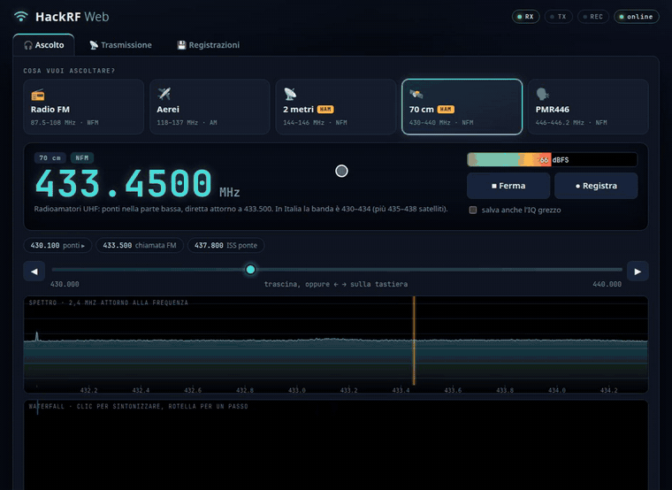
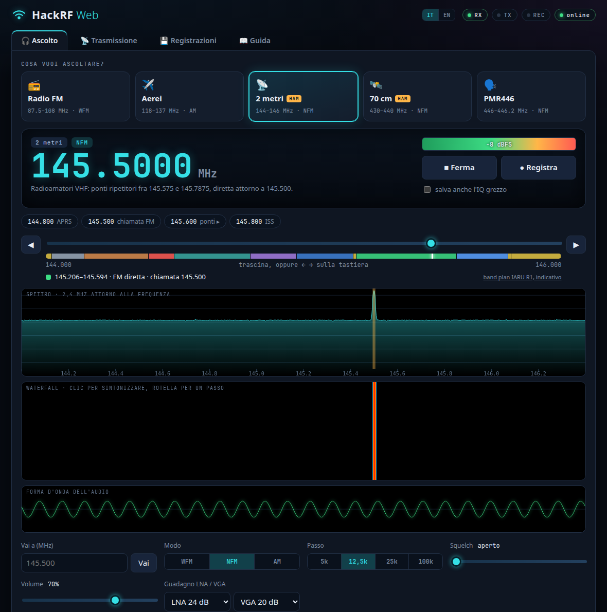
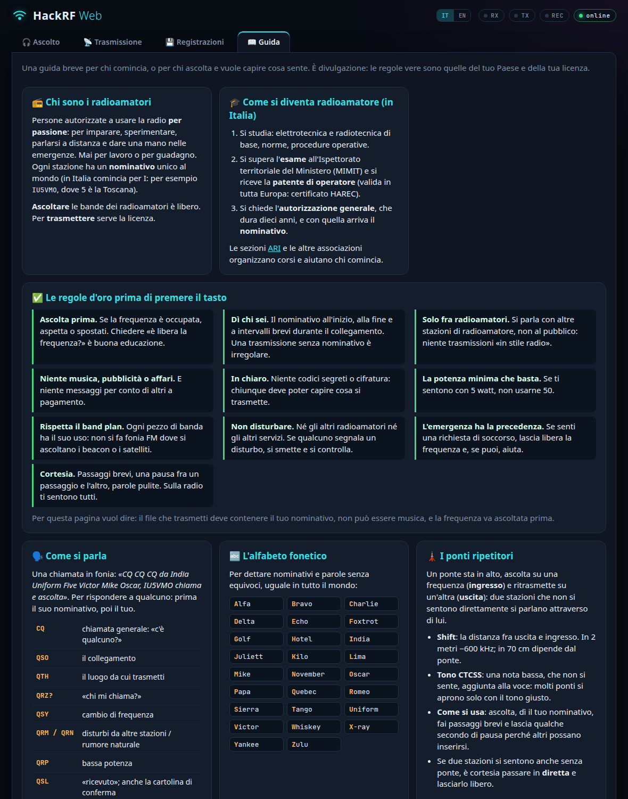

# hackrf-web

Listen with a [HackRF One](https://greatscottgadgets.com/hackrf/one/) from the browser and send an audio file on
the amateur bands. One Docker container, no install on the host.

Made by **IU5VMO** for his own bench and for fellow radio amateurs: take it, use it, tell me what breaks. 73!



🔊 [The same video with sound](docs/transmit.mp4) — the message that went on air.

> Unofficial hobby project, not affiliated with Great Scott Gadgets. As-is, no support.
> **Transmitting needs an amateur radio licence** and is your responsibility; it is off until you turn it on.

## What it does

- **Listen**: pick a band with one click (broadcast FM, airband, **2 m**, **70 cm**, PMR446), slide through it,
  watch spectrum, waterfall and audio waveform, record to WAV or raw IQ. On 2 m and 70 cm a coloured strip shows
  the **band plan** (IARU Region 1, indicative) and the segment you are in.
- **Transmit** (FM): band, frequency, an audio file up to 7 minutes (wav, mp3, ogg, flac), optional CTCSS tone.
  Only inside the bands you allow, RF amplifier always off, a confirmation before every transmission, and a
  warning when the band plan says the segment is not for FM voice.

- **Guide**: a tab for newcomers — who radio amateurs are, the golden rules before keying up, Q codes, the phonetic
  alphabet, repeaters, modes, and the 2 m and 70 cm band plans as readable tables.

| | |
|---|---|
|  |  |
|  |  |

The interface speaks **Italian and English** (switch at the top right; Italian by default — the pictures here are
in Italian). Messages coming from the server are in Italian.

## Quick start

Linux, Docker with Compose v2, a HackRF One your user can open (`hackrf_info` works).

```bash
git clone https://github.com/manzolo/hackrf-web.git
cd hackrf-web
make up        # → http://127.0.0.1:8073
```

Click a band and you are listening. To transmit, put `TX_ENABLE=1` in a `.env` file and `make up` again.
`make down` stops it and frees the HackRF.

**Protect the HackRF**: its input takes −5 dBm at most. If another radio transmits nearby, unscrew the HackRF's
antenna first.

## More

- [Using it](docs/usage.md) — listening, recordings, settings, the `make` commands
- [Transmitting](docs/transmitting.md) — the guard rails, who can give commands, limits you should know
- [How it works](docs/internals.md) — the pipeline, the files, the tests

Status: experimental. Tested on Ubuntu 26.04, HackRF One firmware 2024.02.1, Docker 29.

## Licence

[MIT](LICENSE). The image is built on your machine from Debian and PyPI packages under their own licences (HackRF
tools GPL-2.0, FFmpeg LGPL/GPL, FastAPI, Uvicorn, NumPy, SciPy); no image is distributed from here.
