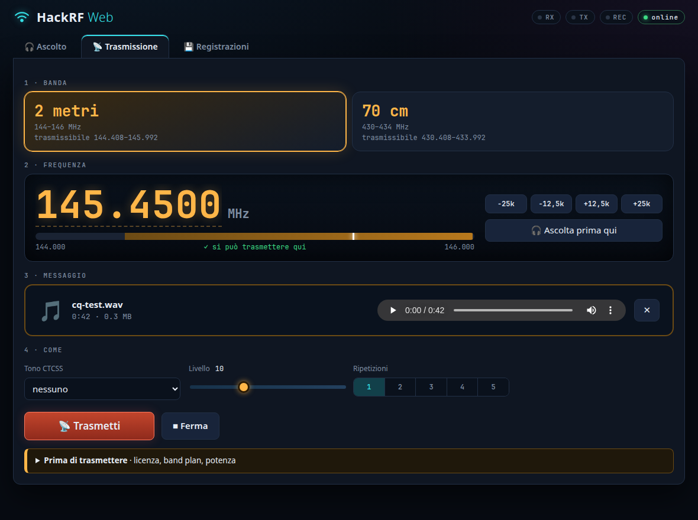
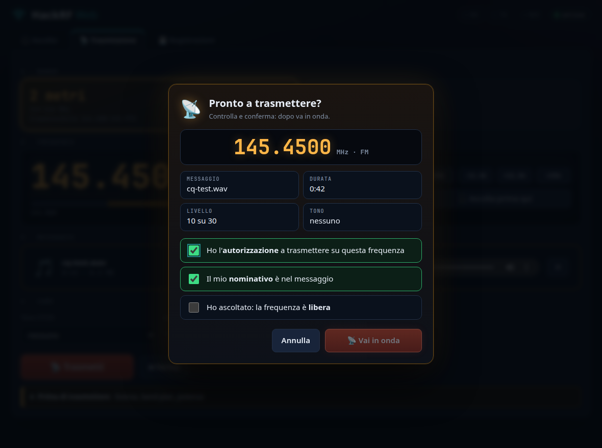

# hackrf-web

> **Disclaimer:** unofficial hobby project, not affiliated with or endorsed by Great Scott Gadgets (makers of the
> HackRF One). Use as-is, at your own risk, no support. **Transmitting requires an amateur radio licence** and must
> follow your country's band plan: you are responsible for every transmission.

A small web page to **listen** with a [HackRF One](https://greatscottgadgets.com/hackrf/one/) and to **transmit
an audio file** on the amateur bands, in a Docker container. Python (FastAPI, NumPy, SciPy) on the server, plain
JavaScript and canvas in the browser, no external assets.


*The pictures come from a demo instance fed by the test suite's fake HackRF (a synthetic carrier on 145.500 MHz).*

**Status: experimental, built for personal use.** Tested on Ubuntu 26.04 with a HackRF One (firmware 2024.02.1)
and Docker 29. The user interface is in **Italian**; the code and this README are in English.

## Features

**Receive**
- Pick a **band** with one click — broadcast FM, airband, **2 m and 70 cm amateur bands**, PMR446 — and the page
  sets mode and step, starts listening and makes the slider span that band (the HackRF retunes by itself as you
  move); well-known frequencies of the band (calling channels, APRS, ISS) are one click away.
  Direct entry, step buttons, ←/→ keys, mouse wheel, click on the waterfall to tune.
- Modes: **WFM** (broadcast FM, 50 µs de-emphasis), **NFM** (amateur FM, CTCSS filtered out), **AM** (airband).
- **Spectrum**, scrolling **waterfall**, audio **waveform**, S-meter in dBFS, squelch, volume, LNA/VGA gains.
- Audio played in the browser (48 kHz PCM over a websocket).
- **Recordings**: demodulated audio as WAV (48 kHz, mono) and optionally the raw **IQ** stream
  (int8 interleaved, 2.4 MS/s, about 4.8 MB/s; centre frequency in the file name). Play, download and delete
  them from the page; they live in `./recordings`.

**Transmit** (off unless you turn it on with `TX_ENABLE=1`)
- Band, frequency, audio file (**wav, mp3, ogg, flac**, drag & drop with preview, up to 7 minutes), optional CTCSS
  tone, level, 1–5 repetitions. FM with 2.5 kHz peak deviation, half a second of carrier before and after. The
  modulated signal is streamed to the HackRF as it is produced, nothing is stored. A recording can be sent back
  with one click.
- Guard rails in the server code, not only in the page:
  - **disabled by default**; nothing is transmitted until `TX_ENABLE=1` is set;
  - only inside `TX_BANDS` (default **144–146 and 430–434 MHz**, the Italian 2 m and 70 cm allocations), counting
    everything that goes on air: the occupied bandwidth (±8 kHz), the residual carrier 200 kHz below (where the
    HackRF is tuned) and the mirror image 400 kHz below. So the lowest 408 kHz and the top 8 kHz of each band are
    refused;
  - the HackRF's RF amplifier is **always off** (`-a 0`), level capped by `TX_MAX_LEVEL`, CTCSS only from the
    standard list;
  - every transmission goes through a confirmation dialog (frequency, file, level, and three boxes to tick:
    authorised on this frequency, callsign in the message, frequency clear);
  - **Stop** cancels at any stage (decoding, between repetitions, on air: terminate, then kill);
  - while transmitting, reception pauses and resumes afterwards (the HackRF is half duplex).





**Who can give commands.** The page can key a transmitter, so the server does not trust the browser's network
position alone: the container port is published on **127.0.0.1 only**; every request must carry a `Host` header
from `ALLOWED_HOSTS` (stops DNS rebinding); every request that changes something must carry a token that is
generated at start and that only a page served by this server can read (stops other web pages open in your
browser from posting to it), and a foreign `Origin` is refused; the websocket checks the same things. There are
no user accounts: do not publish the port on a network.

**Limits you should know**
- The check on `TX_BANDS` knows band edges, not band plans: sub-bands (CW, SSB, satellites, repeater inputs) are up
  to you, and so are your licence conditions.
- The TX level is a gain setting, not a calibrated power, and the HackRF output has no band filter (harmonics).
  For tests use the lowest level that works, a dummy load where possible, an external filter for anything more.
- The HackRF runs at 2.4 MS/s to keep the CPU low; Great Scott Gadgets recommend 8 MS/s or more because of the
  analog filters, so expect more aliases and images than a careful SDR setup would give. Fine for listening and
  bench tests, not a measuring instrument.

## Requirements

- Linux with Docker and Docker Compose v2.
- A HackRF One reachable by your user (on Debian/Ubuntu the `hackrf` package installs udev rules that give the
  `plugdev` group access; check with `hackrf_info`).
- Nothing else on the host: `hackrf_transfer` and ffmpeg are inside the image.

## Quick start

```bash
git clone https://github.com/manzolo/hackrf-web.git
cd hackrf-web
make up        # build and start → http://127.0.0.1:8073
```

Open the page and press **▶ Ascolta** (listen; the first click also unlocks audio in the browser). It starts on
100.0 MHz WFM.

| Command | What it does |
|---|---|
| `make up` | build the image and start the container |
| `make down` | stop it and release the HackRF (needed before using the HackRF from another program) |
| `make test` | run the test suite in a container, with a fake `hackrf_transfer` (never the real radio) |
| `make logs` | follow the container log |

Configuration through the environment (or a `.env` file next to `compose.yaml`):

| Variable | Default | Meaning |
|---|---|---|
| `TX_ENABLE` | `0` | `1` allows transmitting. Leave it off if you only listen. |
| `TX_BANDS` | `144-146,430-434` | where transmitting is allowed, MHz ranges separated by commas. **Set it to your licence and band plan.** |
| `TX_MAX_LEVEL` | `30` | highest TX VGA level accepted (the HackRF goes to 47) |
| `REC_MAX_SECONDS` | `600` | a recording stops by itself after this long (raw IQ is 17 GB per hour) |
| `ALLOWED_HOSTS` | `127.0.0.1:8073,localhost:8073` | `Host` headers the server answers to |
| `UID`, `GID` | `1000` | user the container runs as (owner of the recordings) |
| `PLUGDEV_GID` | `46` | group that owns the HackRF USB node on the host (`ls -l /dev/bus/usb/*/*`) |

The container sees USB through a bind mount of `/dev/bus/usb` and the device cgroup rule `c 189:* rmw`, so
unplugging and replugging the HackRF works without a restart.

## Protect the HackRF input

The receiver input of the HackRF One is rated for about **−5 dBm** (0.3 mW). A 5 W radio transmitting a few
metres away with its antenna can put more than that into the HackRF and damage the front end. **When another
transmitter is nearby, remove the antenna from the HackRF** (unscrew it: collapsing a telescopic one is not
enough), or keep tens of metres and walls between them. When the HackRF itself transmits, its antenna can stay on.

## A use case

Checking a new FM transceiver without a service monitor: record its transmission with the antenna removed from
the HackRF (the WAV tells you what you sound like; the IQ file can be analysed for frequency error, deviation and
CTCSS tone), then send a test message from the HackRF on a simplex frequency and listen to it on the radio.

## How it works

```
hackrf_transfer -r -  ──int8 IQ 2.4 MS/s──▶ engine.py reader thread (50 ms blocks)
                                              ├─ dsp.Demodulator: mix → FIR ÷10 → FIR ÷5 → FM/AM → 48 kHz
                                              ├─ dsp.spectrum (10 frames/s)
                                              └─ WAV / IQ recording
                       websocket /ws ◀────────┘   "S" frames: RSSI + 1024-bin spectrum, "A" frames: int16 audio
browser: canvas (spectrum, waterfall, scope) + Web Audio, REST calls for every command

upload ─▶ ffmpeg (48 kHz mono) ─▶ dsp.modulate_fm ──int8 IQ on stdin──▶ hackrf_transfer -t - … -a 0
```

- `app/dsp.py`: channel selection and demodulation on blocks with stateful filters (a stream cut into blocks of
  any size gives the same audio as one array), spectrum, FM modulator, band checks.
- `app/engine.py`: the HackRF processes (stderr drained, terminate → kill → wait), the reader thread, recordings,
  transmission with cancellation.
- `app/server.py`: FastAPI routes, the request guard, the websocket with a bounded per-browser buffer (half a
  second of audio, latest spectrum, latest status).
- `app/static/`: the page.
- `tools/screenshots.mjs`: retakes the pictures of this README from a demo instance (Chrome headless, no radio).

## Tests

`make test` builds a test image and runs the suite (36 tests) against `fake/hackrf_transfer`, a stand-in that
streams a synthetic FM signal (1 kHz tone), writes statistics on stderr like the real one, logs its arguments and
can be told to fail, die mid-stream or ignore SIGTERM:

- `tests/test_dsp.py`: known synthetic signals in, expected result out — tone frequency and level after NFM, WFM
  and AM demodulation, a signal 50 kHz away stays out, a stronger broadcast station 200 kHz away stays out,
  identical audio in every mode whatever the block size, squelch, spectrum peak position, modulate → demodulate
  round trip, band parsing, and the transmit check at the exact edges.
- `tests/test_api.py`: the whole path through the API — foreign Host, missing or wrong token, foreign Origin and
  strangers on the websocket refused; the stream with the carrier where expected even with a chatty stderr; a slow
  browser gets only fresh frames; tuning inside and outside the window; settings applied all or nothing; a
  recording whose WAV contains the 1 kHz tone; recordings never overwritten, files being written protected, the
  IQ file rotated on retune, symlinks and traversal refused; HackRF unplugged while recording; transmit disabled
  by default and every guard (band, edges, level, confirmation, repetitions, tone, NaN, oversized upload,
  playlists disguised as audio, too long); reception paused and resumed around a transmission with the exact
  number of bytes sent; **Stop** between repetitions, on air against a process that ignores SIGTERM, and before
  it starts; a failure while preparing leaves nothing stuck; mp3; shutdown leaves no process.

The suite was checked against injected defects (band check removed, confirmation removed, RF amplifier turned on,
filter state reset between blocks, token check removed, Stop that does not cancel): each one makes at least one
test fail. Dependencies are pinned and
`pip-audit` reports no known vulnerabilities at the time of writing.

## Licence

[MIT](LICENSE) for the code in this repository. The Docker image is built locally and installs third-party
software from Debian and PyPI under their own licences: HackRF host tools (GPL-2.0), FFmpeg (LGPL/GPL), FastAPI
and Uvicorn (MIT/BSD), NumPy and SciPy (BSD). No image is distributed from this repository.
