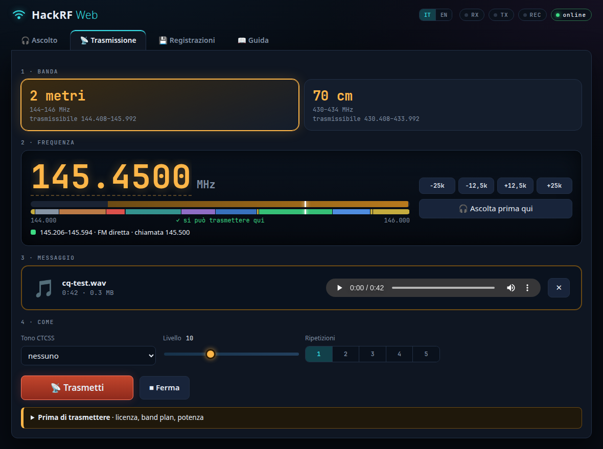

# Transmitting

[← back to the README](../README.md)

Off by default: set `TX_ENABLE=1`. You need an amateur radio licence valid where you are (in Italy: the operator
certificate *and* the general authorisation with a callsign), and your callsign must be in the message.

## What you set

Band, frequency, an audio file (wav, mp3, ogg, flac; drag & drop with preview; up to 7 minutes), an optional
CTCSS tone, the level, 1–5 repetitions. The signal is FM with 2.5 kHz peak deviation, with half a second of
carrier before and after; it is streamed to the HackRF as it is produced, nothing is stored.

## Guard rails (in the server, not only in the page)

- **Bands**: only inside `TX_BANDS` (default 144–146 and 430–434 MHz, the Italian 2 m and 70 cm allocations),
  counting everything that goes on air: the occupied bandwidth (±8 kHz), the residual carrier 200 kHz below (where
  the HackRF is tuned) and the mirror image 400 kHz below. So the lowest 408 kHz and the top 8 kHz of each band
  are refused.
- **Power**: RF amplifier always off (`-a 0`), level capped by `TX_MAX_LEVEL`.
- **Tone**: only standard CTCSS tones.
- **Confirmation**: a dialog shows frequency, file and level and asks for three ticks — authorised on this
  frequency, callsign in the message, frequency clear.
- **Stop** cancels at any stage: while decoding, between repetitions, on air (terminate, then kill).
- Reception pauses during a transmission and resumes afterwards (the HackRF is half duplex).

## Who can give commands

The page can key a transmitter, so the server does not rely on network position alone:

- the container port is published on **127.0.0.1 only**;
- every request must carry a `Host` header from `ALLOWED_HOSTS` (stops DNS rebinding);
- every request that changes something must carry a token generated at start, which only a page served by this
  server can read (stops other web pages open in your browser from posting to it); a foreign `Origin` is refused;
- the websocket checks the same things.

There are no user accounts: do not publish the port on a network.

## Limits you should know

- The band check knows band edges, not band plans: sub-bands (CW, SSB, satellites, repeater inputs) and your
  licence conditions are up to you.
- The level is a gain setting, not a calibrated power, and the HackRF output has no band filter (harmonics). For
  tests use the lowest level that works, a dummy load where possible, an external filter for anything more.
- The HackRF runs at 2.4 MS/s to keep the CPU low; Great Scott Gadgets recommend 8 MS/s or more because of the
  analog filters, so expect more aliases and images than a careful SDR setup gives. Fine for listening and bench
  tests, not a measuring instrument.

## Protect the HackRF input

The receiver input is rated for about **−5 dBm** (0.3 mW). A 5 W radio transmitting a few metres away can put
more than that into the HackRF's antenna and damage the front end. When another transmitter is nearby, **remove
the antenna from the HackRF** (unscrew it: collapsing a telescopic one is not enough), and never connect a
transmitter to it without a properly sized attenuator. When the HackRF itself transmits, its antenna can stay on.

## A use case: checking a new FM radio

Record its transmission with the antenna removed from the HackRF: the WAV tells you what you sound like, the IQ
file can be analysed for frequency error, deviation and CTCSS tone. Then send a test message from the HackRF on a
simplex frequency and listen to it on the radio.
